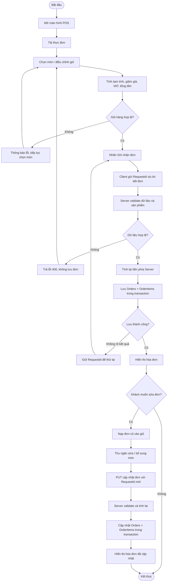

# Đặc tả nghiệp vụ POS – Tạo đơn, thanh toán và sửa đơn vừa tạo

## 1. Tác nhân
- **Thu ngân (Employee):** chọn món, điều chỉnh giỏ hàng, xác nhận và cập nhật đơn.
- **Hệ thống POS:** tính tạm tính/giảm giá/VAT, kiểm tra dữ liệu và hiển thị kết quả.
- **SQL Server:** lưu đơn hàng và chi tiết đơn hàng.

## 2. Luồng chính: tạo đơn và thanh toán
1. Thu ngân mở `/Pos`; hệ thống tải danh sách món đang kinh doanh.
2. Thu ngân chọn món; POS thêm món vào giỏ hoặc tăng số lượng.
3. Thu ngân có thể tăng/giảm số lượng, xóa một món hoặc xóa giỏ hàng.
4. POS tính tạm tính, giảm giá, VAT và tổng tiền để hiển thị.
5. Thu ngân nhấn **Ghi nhận đơn**.
6. Client kiểm tra giỏ không rỗng, số lượng hợp lệ và gửi `RequestId` cùng dữ liệu đơn.
7. Server kiểm tra DataAnnotations, RequestId, danh sách món, số lượng, trạng thái kinh doanh, mã giảm giá và mức VAT.
8. Server tự lấy giá từ danh mục trong CSDL, tự tính lại tiền; không tin giá/tổng tiền do trình duyệt gửi.
9. Server lưu Orders và OrderItems trong transaction. Unique index trên RequestId bảo vệ thao tác gửi lặp.
10. POS hiển thị hóa đơn và mã đơn được ghi nhận.

## 3. Luồng thay thế: dữ liệu không hợp lệ / lỗi mạng
- Giỏ rỗng hoặc số lượng không hợp lệ: Client không gửi thanh toán và hiển thị thông báo.
- Món không tồn tại hoặc đã ngừng bán, mã giảm giá không hợp lệ, VAT không được cấu hình: Server trả HTTP 400; không tạo đơn.
- Mất kết nối hoặc timeout không rõ kết quả: Client giữ nguyên payload và RequestId; thao tác thử lại dùng cùng RequestId để tránh tạo đơn trùng.

## 4. Luồng sửa / bổ sung đơn vừa tạo
1. Từ hóa đơn vừa ghi nhận, thu ngân nhấn **Sửa / Bổ sung món cho đơn này**.
2. POS nạp lại các món còn kinh doanh, số lượng, loại đơn, phương thức thanh toán, ghi chú, mã giảm giá tương ứng và VAT.
3. Thu ngân thêm/bớt/xóa món hoặc điều chỉnh thông tin đơn.
4. Thu ngân nhấn **Cập nhật đơn**.
5. Client gửi PUT `/Pos/UpdateOrder?id={orderId}` với RequestId mới.
6. Server xác minh đơn tồn tại, chưa hủy, kiểm tra RequestId và toàn bộ dữ liệu; tính lại giá từ CSDL.
7. Server thay thế chi tiết OrderItems và cập nhật thông tin Orders trong cùng transaction; giữ nguyên Id, OrderNumber và CreatedAt.
8. Server trả lại hóa đơn đã cập nhật. Gửi lại cùng RequestId cập nhật sẽ trả lại trạng thái hiện tại, không cập nhật lặp.

## 5. Activity Diagram

## 6. Quy tắc dữ liệu quan trọng
- RequestId của mỗi lần tạo/cập nhật phải khác Guid.Empty.
- RequestId duy nhất được lưu tại Orders; lần thử lại phải giữ nguyên RequestId.
- Mỗi ProductId chỉ xuất hiện một lần trong danh sách chi tiết; Quantity từ 1 đến 99.
- Đơn cập nhật giữ nguyên OrderNumber, Id và CreatedAt.
- Tổng tiền luôn được tính lại ở Server từ giá sản phẩm hiện hành và cấu hình giảm giá/VAT.
